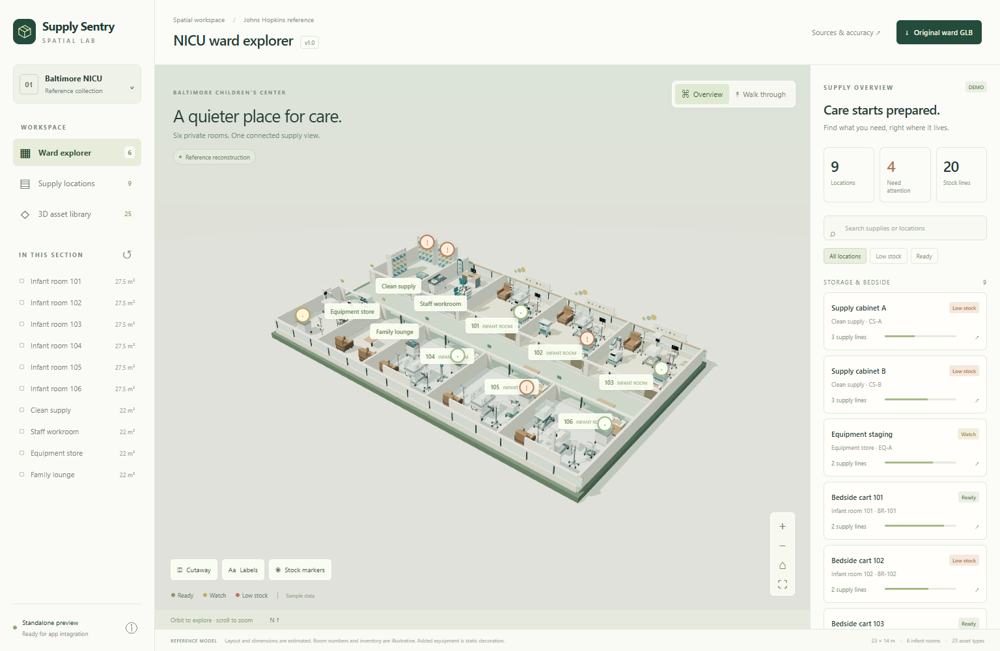

# Supply Vanguard

Nurses and ward staff lose time every shift hunting for equipment, and they can't trust that what they find is clean, charged, or ready to use. In a NICU, that delay or doubt can affect care for the most vulnerable patients.

Supply Vanguard is an equipment and supply tracking tool for hospital wards, with an explorable 3D NICU concept that shows where everything is and what state it's in.



*The 3D ward explorer with supply locations and stock status. Layout and inventory are illustrative, synthetic data.*

## What it does

- **Find equipment:** select an item and locate it in the 3D ward, so staff see which room it is in.
- **Update location and status:** change an item's room or status, and the change shows in the 3D ward. Changes and recent history persist in the browser demo.
- **Keep unsafe equipment out of circulation:** independent stacked holds (dirty, fault, maintenance, unknown) keep an item unavailable until every hold is cleared.
- **Track supplies:** see supply locations and stock levels in the ward, and spot low stock.
- **Know how far to trust a location:** location confidence and stale/uncertain states are handled in the backend; showing them in the UI is planned work.

## Tech stack

- **Runtime:** Node.js 22+ (ES modules, npm workspaces), tested with the built-in `node:test` runner
- **3D ward view:** Three.js (vendored) with 25 GLB equipment models
- **Web app:** plain JavaScript (`apps/web`) for the equipment register
- **Backend:** API service (auth and roles, equipment, holds, requests, supplies, audit) on PostgreSQL 16+ with migrations and tenant-scoped data
- **Observation ingestion:** a service with a simulator; no live hardware integration yet
- **Workflow:** shared task board on a git branch, run with the GitHub CLI, so several agents can claim work without overlapping

The demo uses synthetic data and needs no API keys.

## What's in this repo

Equipment and supply tracking with an explorable NICU concept. This repository contains the complete editable Three.js scene, 25 reusable equipment GLBs, two preserved original ward GLBs, a working browser demo, implementation plan, and shared agent claiming board.

## Start

Requires Node.js 22+, Git, and GitHub CLI for shared task operations.

```sh
npm run dev
# Open http://localhost:4180
npm test
npm run check
```

Select equipment, change its room/status, and locate it in the 3D ward. Changes and recent history persist in this browser. Orbit, walk, inspect equipment models, and explore supply locations in the embedded viewer. No hosted services or API keys are needed for this demo.

## Coordinate work

[Live claiming board](https://github.com/wiltobuild/supply-vanguard/tree/task-board) · [Implementation plan](planning/IMPLEMENTATION_PLAN.md) · [Agent instructions](AGENTS.md)

```sh
gh auth login
npm run board -- list
npm run board -- next --owner YOUR_NAME --agent YOUR_NAME-claude-1
```

Only start after a successful claim. Use separate clones/worktrees for simultaneous agents. The private repository requires collaborator write access for your partner. Local seed files are not the shared board; the CLI synchronizes the remote `task-board` branch with conflict-checked pushes.

## Layout

The [shared UI/UX direction](design/README.md) contains the user-selected homepage reference and requirements for all future app screens.

- `apps/web`: equipment register and scene integration.
- `packages/domain`: versioned equipment updates, sample records and audit events.
- `packages/scene/viewer`: full existing 3D source, vendored Three.js and GLB files under `assets/`.
- `planning`: full roadmap and initial task definitions.
- `tools`: local server, validation, shared task board CLI.
- `tests`: domain and concurrent claiming checks.

The Baltimore Children's Center concept includes six infant rooms and support areas. Layout dimensions, equipment makes and placement are illustrative, not an authenticated Hopkins floor plan. Original reference notes and public sources are preserved in [scene documentation](packages/scene/REFERENCE.md) and the viewer Sources dialog. The demo uses synthetic inventory, manual location updates, and browser storage; authentication, shared database, live tracking and production operations are planned work. The prior Supply Sentry viewer is preserved inside the Supply Vanguard scaffold.

The [fifteen additional NICU models](packages/scene/ADDITIONAL_ASSETS.md) are illustrative static decoration in the live ward, separate from tracked equipment. Open `/ward/additional-gallery.html` for the collection contact sheet, or use the ward's 3D asset library to inspect and download any of the 25 equipment models. The two original ward GLBs remain unchanged baseline snapshots.
