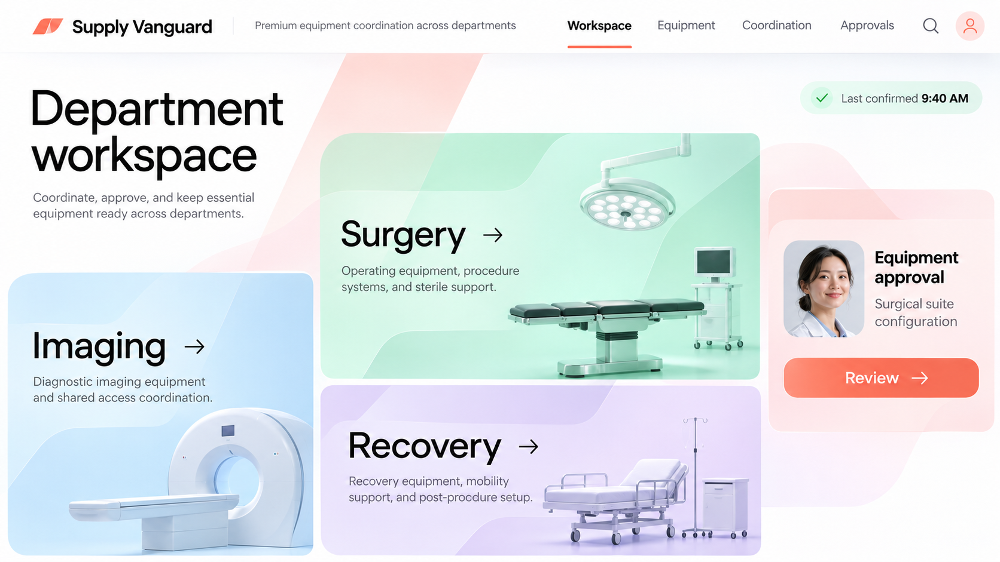

# Supply Vanguard UI/UX direction

The user selected this image on November 4, 2026 as the homepage reference and the visual direction for the rest of the app. Future UI work must consult this document and the original image. This establishes design direction; it does not claim the existing scaffold has already been redesigned.

## Homepage composition

Use the reference's spacious white canvas, strong black typography, coral brand accent and soft blue, mint, lavender and blush surfaces. Build a slim horizontal header with the Supply Vanguard wordmark, a concise descriptor, primary navigation, search and account access. Active navigation uses a coral underline plus a non-color cue such as font weight and aria-current.

Below the header, use an editorial department workspace: a large, left-aligned heading and short explanatory copy; prominent equipment-led department cards; and a compact secondary panel for the next actionable coordination or approval item. Preserve the asymmetric desktop rhythm, generous space, rounded corners, subtle translucent ribbons and clear directional arrows. Decorative ribbons must not obstruct text or controls.

The reference depicts Imaging, Surgery and Recovery. The current working scope is NICU. Make NICU the first usable department, linking into the existing equipment register and explorable ward. Add other departments only when they have meaningful content; do not create clickable dead ends. Any preview department must explicitly say it is a preview. The composition is a reference, not permission to imply capabilities or clinical locations that do not exist.

Use original reusable equipment models from packages/scene/viewer/assets for department imagery or lightweight rendered thumbnails. Avoid auto-running multiple 3D canvases on the homepage. Keep full 3D exploration in the ward workspace. Preserve the original supplied image as the reference; implement the interface as semantic, responsive components rather than a flattened screenshot.

## Shared visual system

- **Typography:** neutral sans serif; large, tightly spaced page headlines; bold card titles; readable secondary gray body text. Suggested starting sizes: desktop hero 64–80 px, mobile hero 36–44 px, card titles 32–48 px, body 16–20 px. Scale to fit content, not fixed image dimensions.
- **Color:** initial approximations are coral #FF6B57, ink #111111, secondary text #565866, white #FFFFFF, blue #DDF2FF, mint #DDF8EE, lavender #EDE3FF and blush #FFE9E9. Validate contrast before adopting these as component tokens. Coral is an action/brand color, not automatically an alert severity.
- **Shape and spacing:** 24–32 px department card radii; smaller 12–16 px controls; an 8 px spacing rhythm; restrained borders/shadows. Dense tables and operational forms should prioritize scanning over oversized homepage spacing.
- **Imagery:** clean equipment renders with soft lighting, consistent angle and calm backgrounds. Do not use the reference portrait as an actual approver identity. Show real authorized user identity or a neutral placeholder.
- **Actions:** one clear primary action per card or panel, with concise verb labels. Arrow icons complement text. Use semantic links for navigation and buttons for mutations.
- **Status:** freshness and readiness indicators must reflect actual observations. Never hard-code the reference's “Last confirmed 9:40 AM”; show the real time/source, stale state, or “Not yet verified.” Pair color with labels/icons.

## Apply across the application

| Surface | Carry forward | Workflow requirement |
|---|---|---|
| Workspace homepage | Department cards, strong hierarchy, coral navigation | NICU entry works; secondary actions use actual records |
| Equipment | Shared header, calm surfaces, consistent type and actions | Search/filter, status, freshness and location stay easy to scan |
| 3D ward | Same header and control styling, compact inspector cards | Keep scene space, orbit/walk controls, model provenance and list fallback |
| Coordination | Pastel grouping, clear ownership and primary actions | Show real task state, blockers and next steps |
| Approvals | Blush accent panel and prominent review action | Use actual requests/permissions; honest empty state until implemented |
| Forms and details | Shared input, button, badge and spacing tokens | Errors beside inputs, preserved entries, clear success/conflict feedback |

Keep engineering coordination (the Git-based agent board) distinct from future clinical equipment coordination and approvals. The homepage reference's “Approvals” does not describe PR approval or grant clinical authority.

## Responsive and accessible behavior

At tablet widths, simplify to two columns; on phones, use a single reading order: heading, active department cards, secondary work panel. Collapse navigation without hiding access to key workflows. Avoid fixed widths and clipped headings. Give actionable controls at least 44 px touch targets, visible focus, meaningful accessible names and keyboard activation. Meet WCAG AA text contrast; do not assume white text on the reference coral passes. Respect reduced-motion preferences and support useful equipment workflows when WebGL is unavailable.

## Implementation acceptance

SV-003 and all subsequent UI tasks must use this direction alongside their existing acceptance criteria. The homepage redesign remains implementation work, not completed by saving this reference.

1. Create shared color, typography, spacing, radius and focus tokens before styling individual screens.
2. Implement the homepage composition with a functioning NICU entry and truthful secondary-panel content.
3. Apply the same navigation, buttons, inputs, status and card language to equipment and ward screens.
4. Verify desktop and narrow-screen layouts, keyboard navigation, contrast and reduced motion.
5. Verify the existing equipment move, status, activity history and 3D selection flows still work.
6. Compare the result against the supplied reference in PR review, documenting intentional adaptations for NICU scope and accessibility.

The original image is user-supplied design reference material. No independent license or ownership verification of depicted imagery has been performed; use the project's original equipment assets for implementation imagery.
