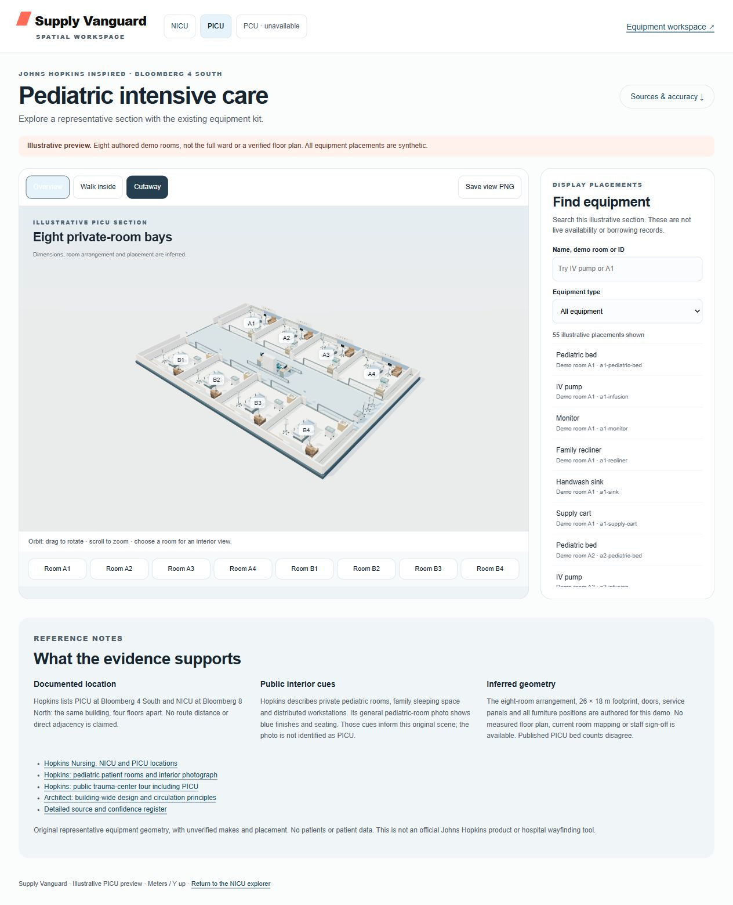
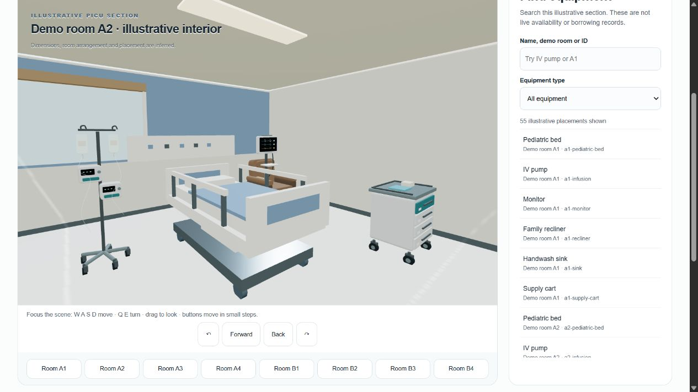

# PICU illustrative section — SV-025

Open `/ward/wards/picu/index.html` after `npm run dev` (default port 4180). The review server used port 4186. The NICU explorer now has additive ward navigation; the PCU route becomes a link only after its entry document is available. This PR does not depend on the separate PCU implementation.

The eight authored private-room bays, staff workspace and equipment bay are an illustrative section inspired by public Hopkins references. They are **not** a verified PICU floor plan, full unit capacity, current equipment inventory or hospital wayfinding map. The [source register](references.json) records exactly what was inspected, the published 40-versus-28-bed discrepancy and the absence of measured drawings. Source identity is Bloomberg 4 South; NICU is Bloomberg 8 North in the same building. Four floors apart does not establish a measured travel route.

## Use

- Orbit the cutaway with drag/scroll. Choose any room button for its interior.
- `Walk inside` enters the corridor. Focus the scene, use W/A/S/D to move and Q/E or left/right arrows to turn, or drag to look. On-screen buttons offer keyboard and touch alternatives. Collision footprints remain active even when walls are cut away.
- Search by equipment name, demo room or stable ID; filter by type. Selecting an item shows its room. `Show all of this type` highlights every matching display placement in the overview. No operational availability is inferred.
- `/ward/wards/picu/index.html?view=list` exercises the list-only experience without creating a WebGL context. Rendering failure uses the same equipment list and source notes. No-script text describes the section and links the register.
- `Save view PNG` exports the rendered view with an illustrative-model caption. Browser-download verification is recorded separately below.

## Files and integration

`config.js` contains meter/Y-up placements, namespaced `picu-*` IDs, bounds and collision rules. `ward.js` reuses the original `createAsset()` models for pumps, monitors, carts, recliners, sinks, workstations and a cabinet. Only the representative pediatric bed and architecture are ward-local additions. No original model source, room ID, GLB or manifest is replaced. `app.js` builds the independent searchable list before attempting dynamic Three.js imports, so the list survives rendering failure.

The only existing shared file changed is `viewer/index.html`, with a ward-link nav and a module import. `wards/ward-links.js` checks each known route and requires its `data-ward` marker before offering a link. Unavailable previews remain text. PCU integration may add its own `data-ward-links="pcu"` nav and import `../ward-links.js`; the independent PCU PR initially retains plain NICU/workspace return links.

The local `three-loader.mjs` is a Node test resolver for the existing vendored browser module; it adds no runtime dependencies and does not change the root test loader. Tests stay inside the assigned ward scope:

```sh
node --test packages/scene/viewer/wards/picu/picu.test.mjs packages/scene/viewer/wards/picu/selection.test.mjs
npm ci --prefix services/api/auth --ignore-scripts
npm test
npm run check
```

## Verification — 2026-11-05

Story: NICU ward link → PICU static page/config → reused Three.js models → inspect/search/walk → return to NICU. This preview has no API or database boundary, credentials, live observations or mutations.

| Check | Evidence |
| --- | --- |
| Ward tests | 13 passed: the original seven geometry/search/navigation/provenance tests plus focus/list identity, show-type focus transfer, supported equipment route, delayed history restoration with late scene initialization, unchanged cached-page focus, and unchanged-filter selection clearing |
| Root tests | 45 passed, 6 skipped (native PostgreSQL unavailable to the repository test harness). No failures after installing the declared locked PGlite test dependency and running with normal temp-directory access |
| Repository check | Passed: JavaScript syntax, 12 original GLB containers, existing task definitions |
| Browser rendering | IAB overview, A2 room interior and corridor rendered; final renderer log had no errors or warnings. A deprecated soft-shadow mode was replaced with the vendored module's supported PCF mode |
| Search/selection | IV pump filter shows 10 placements; A1+IV pump shows 1; selecting an item and `Show all of this type` returns to overview with the same type matches |
| Navigation | NICU → PICU → NICU links work. PCU is shown unavailable on this isolated branch; future PCU availability is unit tested, not claimed as browser integration tested |
| Accessible fallback | `?view=list` creates zero canvas elements; A1+IV pump search and Enter-key item selection work. WebGL context-loss handling exists but deliberate GPU loss was not injected |
| Narrow screen | 390 × 844 viewport checked; document width 375 with scrollbar, no horizontal overflow; viewport override reset |
| Keyboard | Enter activates the forward navigation control; room and search controls are labeled semantic controls. Free-walk collision behavior is unit tested. No screen-reader hardware audit claimed |
| Image evidence | Actual browser captures in [evidence](evidence/): overview, interior, corridor, IV-pump search, mobile and list fallback. These are renders of this illustrative model, not photographs of the real PICU |
| PNG export | Automation download-event wait timed out after the export attempt. Download outcome was not confirmed by that event; browser screenshots were saved independently and remain the review evidence |

Initial sandbox test attempts failed on temp-directory access and a missing declared PGlite package. Those environment conditions were resolved without editing auth, dependencies, CI or root scripts. Root native database tests remain skipped and must not be described as passed. No performance/FPS target, measured architectural accuracy, real-world equipment placement or ward-staff sign-off is claimed.

Before any fidelity claim: obtain approved measured geometry and current room mapping, equipment dimensions/placement evidence, and facilities/ward-staff review. These are external evidence requirements, not completed by this illustrative scene.

### PR review corrections

Selection updates the existing list buttons' pressed state, preserving the active button and list scroll rather than recreating the list. If the focused `Show all of this type` action hides its own panel, focus moves to the equipment type filter. The header Equipment workspace link now targets `/#/equipment`.

Browser regression sequence repeated in both ordinary 3D (one canvas) and `?view=list` (zero canvases): press Enter on the A1 pump, verify the pump remains the active/pressed button, press Tab to reach the A1 monitor, and press Enter again to verify monitor focus/selection. In fallback, activate show-type and verify focus reaches the type filter and nine monitors remain. Follow Equipment workspace, verify the Equipment page/title at `/#/equipment`, then use Back and verify the PICU page returns. Actual focused controls are captured in `evidence/keyboard-selection.jpg` and `evidence/keyboard-fallback.jpg`.

`selection.test.mjs` executes the actual list-only entry point in a small DOM fixture which resets focus when a focused node is detached. It covers the selection-handler regression and list identity; native Enter/Tab behavior is verified by the browser sequence above. Root tests and repository check were rerun after these corrections. The shared selector and PCU-local files remain unchanged.

### Browser history restoration

Browsers can restore search/type controls after `pageshow` without sending input events. The page now recomputes results on the next task after `pageshow` or `popstate`, and rereads the controls when the asynchronous scene becomes ready. The count, list and highlight function receive the same result set. Unchanged filters retain their existing buttons and focus; a selection outside the new results is cleared. The canvas description lists the placements actually outlined, providing a textual equivalent of the highlights.

Real IAB Back/Forward regression, 2026-11-05:

1. Filter A1 + IV pump, follow Equipment workspace, verify the Equipment page, then Back: A1/infusion controls, one result (`picu-room-a1-infusion`), one outlined A1 pump, scene ready.
2. Forward to Equipment, open another PICU history entry, filter B2 + Monitor, then Back to Equipment and Forward into PICU: B2/monitor controls, one result (`picu-room-b2-monitor`), one matching outline. Enter retains focus on that monitor.
3. Open `?view=list`, filter A1 + IV pump, follow Equipment and Back, then Back to the preceding 3D page and Forward into list mode: A1/infusion controls and exactly one pump in both restorations; zero canvases throughout list mode. Enter retains pump focus.

The observed DOM results are saved in [history-restoration.json](evidence/history-restoration.json); browser renders are in [history-back-3d.jpg](evidence/history-back-3d.jpg) and [history-back-list.jpg](evidence/history-back-list.jpg). The fallback image was captured after the Forward return. No console errors/warnings were recorded. A stopped preview server was restarted before these checks; its stale connection-error tab was replaced with a fresh valid preview tab. The cached-page event case is also covered by the DOM fixture; no claim is made that the browser used its back-forward cache on every navigation.




